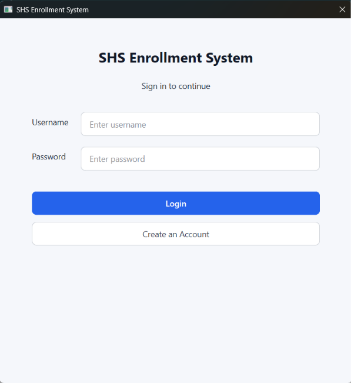
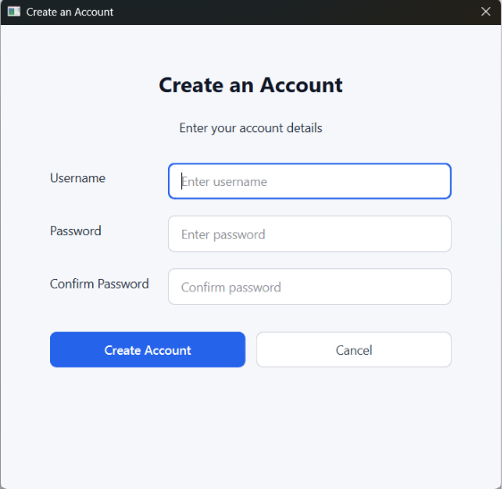
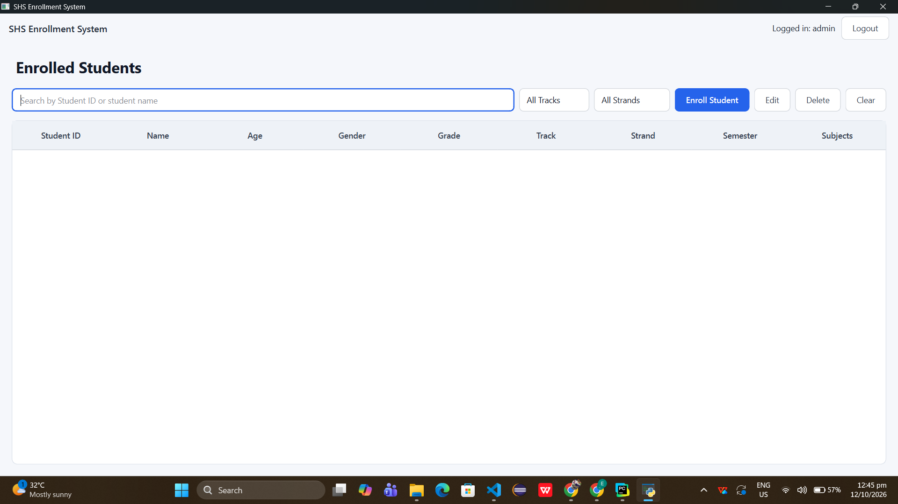
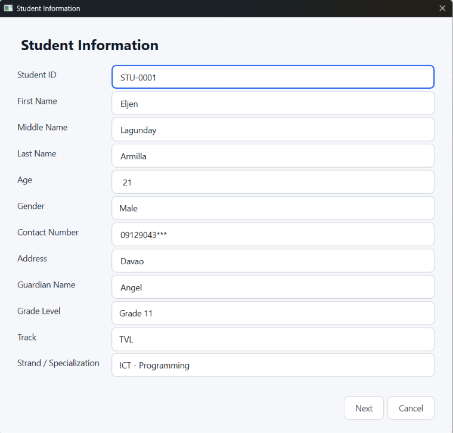
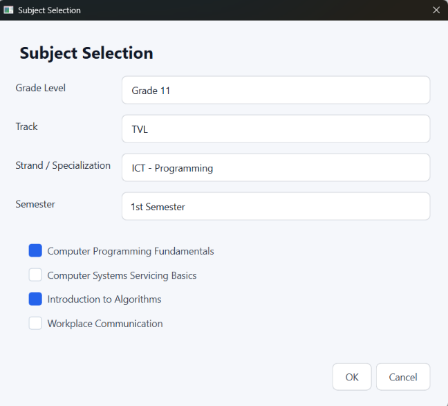
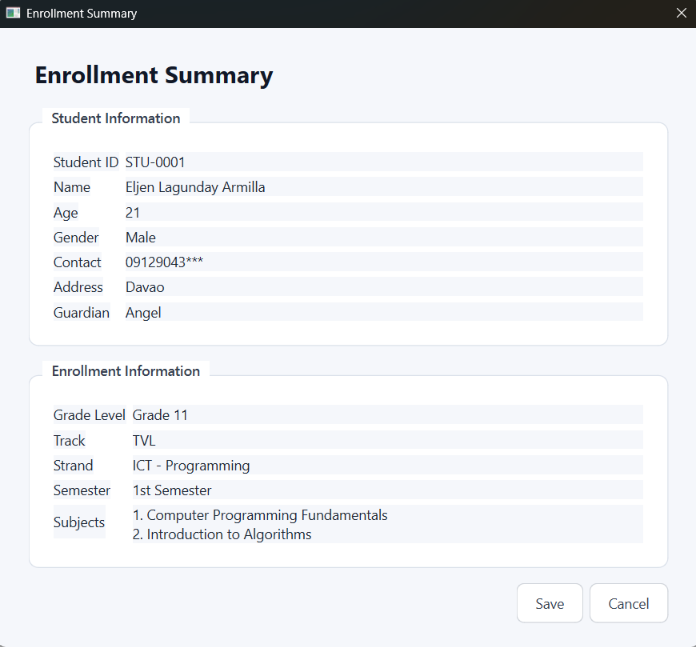
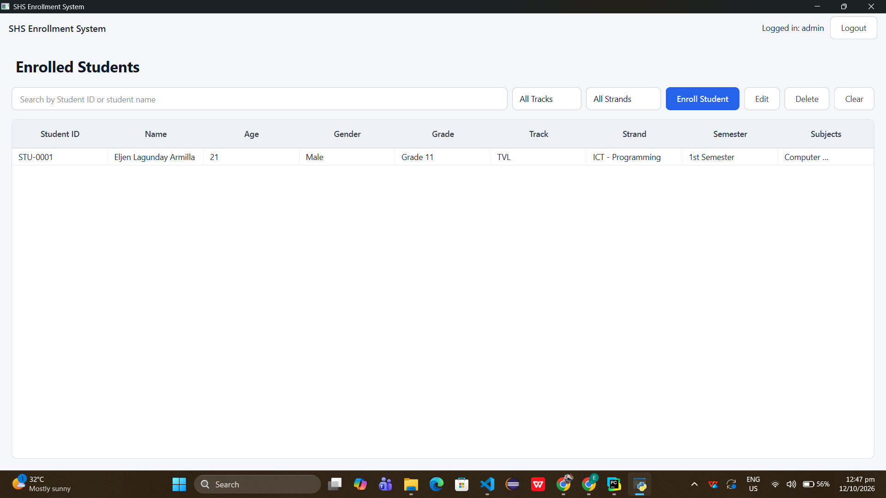

# Senior High School Enrollment System

## Project Description

The **Senior High School Enrollment System** is a desktop application developed using Python, PyQt6, and SQLite to help organize the enrollment process for Senior High School students. It provides a graphical user interface where authorized users can register or sign in, record student information, select academic details and subjects, review enrollment summaries, and manage saved enrollment records.

The system supports **Grade 11 and Grade 12** under four tracks: **Academic**, **Technical-Vocational-Livelihood (TVL)**, **Arts and Design**, and **Sports**. Each track has predefined strands or specializations and corresponding subjects. Available subjects are retrieved according to the selected grade level, track, strand or specialization, and semester. The system also supports searching enrollment records by student ID or student name, filtering records by track and strand, viewing student details, editing enrollment information, and deleting records after confirmation.

Instead of keeping enrollment information in separate manual records, the application stores its data in a local SQLite database. Its interface, authentication functions, enrollment operations, and database operations are organized into separate modules to make the project easier to understand and maintain.

## Project Objectives

The main objective of this project is to develop a desktop-based Senior High School Enrollment System that provides an organized and convenient way to record, store, and manage student enrollment information and selected subjects. Specifically, the system aims to provide user authentication, collect student personal information, support Grade 11 and Grade 12 academic classifications, display the appropriate subjects for each track and strand or specialization, generate unique student IDs, and allow users to review, search, filter, view, edit, and delete enrollment records. It also aims to store information persistently in an SQLite database and provide a graphical interface that makes the enrollment workflow easier to follow.

## Features

The Senior High School Enrollment System provides four main user-facing features: authentication, student enrollment, enrollment record management, and record filtering.

### 1. User Authentication

**Location:** `features/authentication/`

- **User Login:** Allows registered users to sign in with their username and password before accessing the enrollment window.
- **Account Registration:** Allows a new user to create an account through the registration dialog.
- **Required-Field Validation:** Checks that the username and password fields are provided during registration.
- **Username Validation:** Requires a username of at least three characters and prevents duplicate usernames.
- **Password Validation:** Requires a password of at least six characters.
- **Logout:** Ends the current session and returns the user to the login screen.

### 2. Student Enrollment

**Location:** `features/enrollments/`

- **Student Information Entry:** Collects the student's first name, middle name, last name, age, gender, contact number, address, and guardian information.
- **Automatic Student ID Generation:** Generates a student ID in the `STU-0001` format for a new student record.
- **Grade Level Selection:** Supports Grade 11 and Grade 12.
- **Track Selection:** Supports Academic, Technical-Vocational-Livelihood (TVL), Arts and Design, and Sports.
- **Strand or Specialization Selection:** Presents the strands or specializations associated with the selected track.
- **Semester Selection:** Allows the user to select the semester for the enrollment.
- **Subject Selection:** Retrieves predefined subjects that match the selected grade level, track, strand or specialization, and semester.
- **Enrollment Summary:** Displays the student's information, academic classification, semester, and selected subjects so the user can review the details before saving.

#### Supported Tracks and Strands / Specializations

| Track | Strands / Specializations |
|---|---|
| **Academic** | STEM, ABM, HUMSS, GAS |
| **Technical-Vocational-Livelihood (TVL)** | ICT - Programming, ICT - CSS, Home Economics (HE), Shielded Metal Arc Welding (SMAW), Agri-Fishery Arts (AFA) |
| **Arts and Design** | Visual Arts, Music, Dance, Theater, Media Arts, Literary Arts |
| **Sports** | Sports Coaching, Sports Officiating |

The available subjects are predefined in `database/database.py`. The application retrieves subjects that match the student's selected academic classification and semester.

### 3. Enrollment Record Management

**Location:** `features/enrollments/views/enrollment_view.py`

- **Enrollment Table:** Displays saved enrollment records in the main window.
- **View Student Details:** Opens a view of the information stored for a selected enrollment.
- **Edit Enrollment:** Allows the user to open a saved record and update the available information.
- **Delete Enrollment:** Removes a selected record after the user confirms the deletion.

### 4. Record Search and Filtering

**Location:** `features/enrollments/views/enrollment_view.py`

- **Search by Student ID:** Finds records using a student's generated ID.
- **Search by Student Name:** Allows users to locate records using a student's name.
- **Filter by Track:** Narrows the displayed records according to the selected track.
- **Filter by Strand:** Narrows the displayed records according to the selected strand or specialization. The strand filter follows the selected track.
- **Clear Search and Filters:** Resets the current search and filter selections.

The database and other implementation details are described in the **Technologies Used**, **Object-Oriented Programming (OOP) Implementation**, and **Database** sections below. They support the features but are not listed as separate user-facing features.

## Technologies Used

| Technology | Purpose |
|---|---|
| Python | Main programming language used for the application's logic and functionality. |
| PyQt6 | Provides the desktop graphical user interface, including windows, forms, dialogs, tables, and controls. |
| SQLite | Stores user accounts, student information, available subjects, enrollment records, and selected subjects in a local database. |
| `sqlite3` | Python library used to connect to and interact with the SQLite database. |
| Qt Style Sheets (QSS) | Defines the application's interface styling through `style.qss`. |
| Git | Tracks changes to the project's source code through version control. |
| GitHub | Hosts the project's source code repository. |
| PyCharm | Integrated development environment used to develop and run the application. |

## Project Structure

```text
SHSEnrollmentSystemV2/
├── database/
│   ├── __init__.py
│   └── database.py
├── features/
│   ├── __init__.py
│   ├── authentication/
│   │   ├── __init__.py
│   │   ├── service.py
│   │   └── view.py
│   └── enrollments/
│       ├── __init__.py
│       ├── service.py
│       └── views/
│           ├── __init__.py
│           ├── enrollment_view.py
│           ├── student_dialog.py
│           ├── student_view.py
│           ├── subject_dialog.py
│           └── summary_dialog.py
├── README_screenshots/
│   ├── 01-login.png
│   ├── 02-create-account.png
│   ├── 03-enrolled-students-empty.png
│   ├── 04-student-information.png
│   ├── 05-subject-selection.png
│   ├── 06-enrollment-summary.png
│   └── 07-enrolled-students-record.png
├── main.py
├── school.db              # Created automatically when the application runs
├── style.qss
└── README.md
```

> **Note:** `school.db` is generated automatically when the application initializes the database. If it is not present in a fresh copy of the project, run the application to create it.

### Major Files and Folders

| File / Folder | Description |
|---|---|
| `main.py` | Starts the application and coordinates the authentication and main-window flow. |
| `database/` | Contains the database connection and initialization code. |
| `database/database.py` | Creates the SQLite tables and inserts the initial account and subject data. |
| `features/authentication/` | Contains the authentication service and login/account-registration interface. |
| `features/authentication/service.py` | Handles login validation and account-registration operations. |
| `features/authentication/view.py` | Provides the login interface and account-registration dialog. |
| `features/enrollments/` | Contains the service and views used for student enrollment and record management. |
| `features/enrollments/service.py` | Handles enrollment database operations, subject retrieval, and record management. |
| `features/enrollments/views/enrollment_view.py` | Displays enrollment records and provides search, filtering, and record-management actions. |
| `features/enrollments/views/student_dialog.py` | Collects student personal information and academic enrollment details. |
| `features/enrollments/views/subject_dialog.py` | Displays the available subjects and handles subject selection. |
| `features/enrollments/views/summary_dialog.py` | Displays the enrollment summary before saving. |
| `features/enrollments/views/student_view.py` | Displays the details of a saved student enrollment. |
| `style.qss` | Contains the application's Qt Style Sheet rules. |
| `README_screenshots/` | Contains screenshots documenting the application interface and workflow. |

## Installation and Setup

### System Requirements

- Windows 10 or Windows 11
- Python 3
- PyQt6
- SQLite (included with standard Python distributions)
- Git (optional, if cloning the repository)
- PyCharm or another Python-compatible IDE (optional)

### Step 1: Clone the Repository

Open a terminal and run:

```bash
git clone https://github.com/doughdong/SHSEnrollmentSystemV2.git
```

### Step 2: Open the Project Folder

```bash
cd SHSEnrollmentSystemV2
```

If you already have the project files, open a terminal in the project folder and continue to the next step.

### Step 3: Create a Virtual Environment

```bash
python -m venv .venv
```

A virtual environment keeps the project's Python packages separate from other Python projects on the computer.

### Step 4: Activate the Virtual Environment

For Windows PowerShell:

```powershell
.\.venv\Scripts\Activate.ps1
```

If activation is restricted by the system's execution policy, use the virtual environment's Python executable directly for the installation and run commands.

### Step 5: Install PyQt6

```bash
python -m pip install PyQt6
```

If you are using PyCharm, make sure the selected project interpreter is the `.venv` interpreter. You can also open the PyCharm terminal and run the installation command there.

### Step 6: Run the Application

```bash
python main.py
```

The application initializes the SQLite database and creates the required tables and initial subject data when it starts. The `school.db` file is generated in the project root if it does not already exist.

## How to Use the System

### 1. Launch the Application

1. Open the project folder in a terminal or in PyCharm.
2. Make sure the correct Python environment is selected and PyQt6 is installed.
3. Run `python main.py`.
4. Wait for the authentication window to appear.

### 2. Register an Account

1. Open the account-registration option from the login interface.
2. Enter a username with at least three characters.
3. Enter a password with at least six characters.
4. Complete the required fields.
5. Submit the registration form.
6. If the username is already registered or the fields do not meet the requirements, correct the information and try again.
7. Return to the login screen and sign in with the registered credentials.

### 3. Log In

1. Enter your registered username.
2. Enter the corresponding password.
3. Submit the login form.
4. If the credentials are accepted, the main enrollment window opens.

### 4. Start a Student Enrollment

1. From the enrollment window, choose the action for creating a student enrollment.
2. Enter the student's personal information, including the name, age, gender, contact number, address, and guardian.
3. Check the entered information before proceeding.
4. Continue to the academic classification and subject-selection steps.

### 5. Select the Academic Details

1. Select **Grade 11** or **Grade 12**.
2. Select the appropriate track: Academic, TVL, Arts and Design, or Sports.
3. Select the strand or specialization available under the chosen track.
4. Select the semester.
5. Review the available subjects shown by the application. The list is based on the selected grade level, track, strand or specialization, and semester.

### 6. Select Subjects and Review the Summary

1. Choose the subjects for the student's enrollment.
2. Continue to the enrollment summary.
3. Review the student's personal information.
4. Check the grade level, track, strand or specialization, semester, and selected subjects.
5. If the details are incorrect, return to the appropriate step and make the necessary changes.
6. Confirm the information before saving.

### 7. Save the Enrollment

1. Confirm the enrollment in the summary dialog.
2. The application saves the enrollment information and selected subjects in the SQLite database.
3. Return to the enrollment records window.
4. Check that the saved enrollment appears in the table.

New student records receive a generated student ID in the `STU-0001` format.

### 8. Search for an Enrollment Record

1. Locate the search field in the enrollment window.
2. Enter the student's ID or name.
3. Review the matching records displayed in the table.
4. Clear the search when you want to display the records again.

### 9. Filter Enrollment Records

1. Select a track filter to narrow the displayed records.
2. If needed, select a strand or specialization filter.
3. Review the records matching the selected filters.
4. Use the clear option to reset the search and filters.

### 10. View an Enrollment Record

1. Locate the student in the enrollment table.
2. Select the record.
3. Choose the action for viewing the student's details.
4. Review the saved personal information and enrollment details.

### 11. Edit an Enrollment Record

1. Find and select the record to be changed.
2. Choose the edit action.
3. Update the necessary student or academic details.
4. Review the selected subjects and enrollment summary.
5. Save the changes and check the updated record in the table.

### 12. Delete an Enrollment Record

1. Find and select the enrollment record.
2. Choose the delete action.
3. Read the confirmation prompt carefully.
4. Confirm only if you intend to remove the record.
5. Check the enrollment table to verify that the record is no longer displayed.

Deleting records should be done carefully because the operation removes saved data.

### 13. Log Out

1. Choose **Logout** from the application.
2. The current session ends.
3. The application returns to the authentication screen.

### Default Demonstration Account

The database initialization code is documented as creating the following demonstration account:

| Username | Password |
|---|---|
| `admin` | `admin123` |

Use these credentials only if they are present in your current copy of the database initialization code. The default account is intended for demonstration and testing; replace or remove default credentials and improve password storage before using the application with real student information.

## Object-Oriented Programming (OOP) Implementation

The project uses classes to organize the application's responsibilities. The database class manages database access, service classes handle application operations, and PyQt6 view and dialog classes provide the graphical interface.

### Important Classes

| Class | Purpose |
|---|---|
| `Database` | Manages SQLite connections, table creation, and initial database data. |
| `AuthenticationService` | Handles login validation and account registration. |
| `AuthenticationView` | Provides the login interface. |
| `SignupDialog` | Provides the account-registration interface. |
| `EnrollmentService` | Handles enrollment data operations and retrieves available subjects. |
| `EnrollmentView` | Displays and manages enrollment records. |
| `StudentInformationDialog` | Collects student information and academic classification. |
| `SubjectSelectionDialog` | Handles subject selection for an enrollment. |
| `EnrollmentSummaryDialog` | Displays enrollment details for review before saving. |
| `StudentViewDialog` | Displays the details of a saved enrollment. |
| `MainWindow` | Provides the main application window and access to enrollment management. |
| `ApplicationController` | Coordinates the login screen, main window, and logout flow, if implemented in the application's entry-point code. |

### Encapsulation

Encapsulation is applied by grouping related responsibilities into separate classes and modules. For example, `AuthenticationService` handles authentication-related operations, while `EnrollmentService` handles enrollment operations and subject retrieval. The database module is responsible for database connections and initialization, while the views and dialogs manage user interaction.

This separation helps keep the graphical interface from containing all database and business logic in one place and makes the code easier to maintain.

### Inheritance

The project uses inheritance through PyQt6. Application windows, widgets, and dialogs extend PyQt6 classes to obtain standard interface behavior and provide project-specific functionality. For example, a main window can use `QMainWindow`, a dialog can use `QDialog`, and a custom interface component can use `QWidget` as its base class.

### Polymorphism

The application's custom interface classes use behavior inherited from PyQt6 and define their own event-handling and interaction logic. Where a subclass overrides a framework method, the subclass provides behavior suited to the enrollment system. The exact examples should match the methods implemented in the source code.

### Separation of Responsibilities

The project is organized so that different parts of the application have specific responsibilities:

- **Database layer:** Connects to SQLite, creates tables, and initializes data.
- **Service layer:** Handles authentication and enrollment operations.
- **View and dialog layer:** Displays windows, forms, enrollment tables, subject selection, and summaries.
- **Application entry point:** Starts the application and coordinates its initial flow.

This organization helps make the application easier to follow, test, and extend.

## Database

The application uses **SQLite**, a local relational database, to store user accounts, student information, available subjects, enrollment records, and selected subjects. Database connections, table creation, and initial data setup are handled by `database/database.py`. The database is initialized automatically when the application starts.

### Database Name

```text
school.db
```

The database file is generated in the project root when the application initializes the database.

### Database Tables

| Table | Purpose | Key Information |
|---|---|---|
| `users` | Stores accounts used to access the application. | `id`, `username`, `password` |
| `students` | Stores each student's personal information. | `id`, `student_id`, `first_name`, `middle_name`, `last_name`, `age`, `gender`, `contact`, `address`, `guardian` |
| `subjects` | Stores the available subjects for each academic classification and semester. | `id`, `grade_level`, `track`, `strand`, `semester`, `subject_name` |
| `enrollments` | Stores the academic enrollment details associated with a student. | `id`, `student_id`, `grade_level`, `track`, `strand`, `semester` |
| `enrollment_subjects` | Stores the subjects selected for a specific enrollment. | `id`, `enrollment_id`, `subject_name` |

### Database Relationships

- A student record is connected to an enrollment through the student's ID.
- An enrollment can contain multiple selected subjects through `enrollment_subjects`.
- Foreign keys connect enrollment records with their related student and selected-subject records.
- Database constraints help prevent duplicate values for identifiers such as usernames and student IDs, as well as duplicate subject classifications where configured.

### Database Operations

| Operation | How It Is Used |
|---|---|
| **Create** | Adds user accounts, student records, enrollment records, and selected-subject records. |
| **Read** | Retrieves account information for login validation, available subjects, enrollment records, and selected subjects. |
| **Update** | Updates student information, enrollment classification, semester, and selected subjects. |
| **Delete** | Removes enrollment records through the application's delete workflow. Related records are handled according to the database relationships and deletion logic. |
| **Search** | Finds enrollment records using a student ID or student name. |
| **Filter** | Filters displayed enrollment records by track and strand or specialization. |

## Screenshots

The following screenshots document the main screens and workflow of the Senior High School Enrollment System. They are stored in the `README_screenshots/` folder.

### 1. Login Screen

The login screen allows a registered user to enter their username and password to access the application.



### 2. Create an Account

The account-registration dialog allows a new user to create an account. The registration process validates required fields, username length, password length, and duplicate usernames.



### 3. Enrolled Students — Empty Records

The main enrollment window displays the enrollment table and available record-management actions. This screenshot shows the interface before any enrollment records are displayed.



### 4. Student Information

This form collects the student's personal information and academic enrollment details, including grade level, track, and strand or specialization.



### 5. Subject Selection

The subject-selection dialog displays the predefined subjects that match the selected grade level, track, strand or specialization, and semester.



### 6. Enrollment Summary

The enrollment summary allows the user to review student information, academic details, and selected subjects before saving the enrollment.



### 7. Enrolled Student Record

The main table displays a saved enrollment record, allowing users to search for and manage enrollment information.



## Testing

The following application flow can be checked during testing:

| Test | Expected Result |
|---|---|
| Launch the application | The database is initialized and the login screen appears. |
| Log in with valid credentials | The main enrollment window opens. |
| Register a new account | A valid, unique account is saved. |
| Start a student enrollment | The student-information form opens. |
| Select academic details | Available subjects match the selected grade level, track, strand, and semester. |
| Review the enrollment | The summary displays the entered information and selected subjects. |
| Save the enrollment | The saved record appears in the enrollment table. |
| Search for a record | Matching records are displayed. |
| Filter by track or strand | The table displays records matching the selected filter. |
| View, edit, or delete a record | The selected record can be viewed or managed through the available actions. |
| Log out | The application returns to the login screen. |

## Known Issues / Limitations

1. **Local Database:** The system uses a local SQLite database and does not synchronize records between multiple computers.
2. **Predefined Subject Catalog:** Tracks, strands or specializations, and subjects are initialized in the database code. There is no separate interface for managing the subject catalog.
3. **Limited User Roles:** The system does not currently provide separate permissions for different user roles.
4. **Password Storage:** The current authentication implementation stores passwords as plain text. This is a security limitation and must be addressed before the system is used with real student information.
5. **No Password Recovery:** A forgot-password or account-recovery workflow is not included.

## Future Improvements

Possible improvements for a future version include:

- Implement secure password hashing and safer account management.
- Add administrator and staff roles with different permissions.
- Provide a user interface for adding, editing, and removing subjects.
- Add password recovery and account-management functions.
- Add export options for enrollment reports in PDF or Excel format.
- Improve validation and provide clearer error messages.
- Add automated unit and integration tests for authentication, enrollment, and database operations.
- Add backup and restore options for the SQLite database.
- Improve reporting and filtering for enrollment records.
- Add a more detailed audit trail for enrollment changes.

## Author

**Name:** Eljen Armilla  
**Program/Year:** BSCS, 2nd Year
